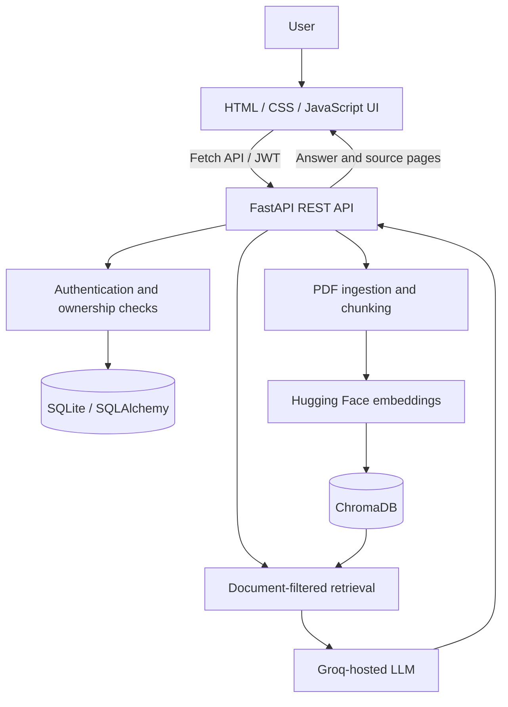
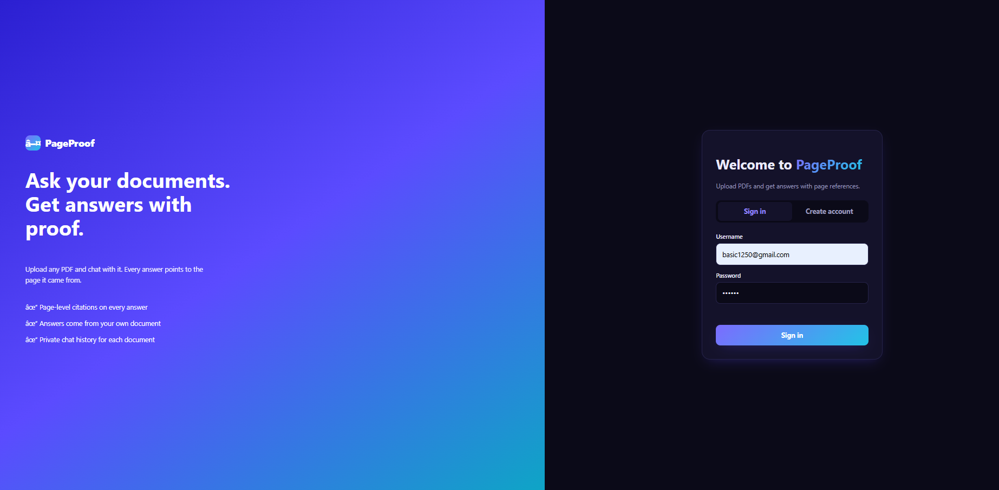
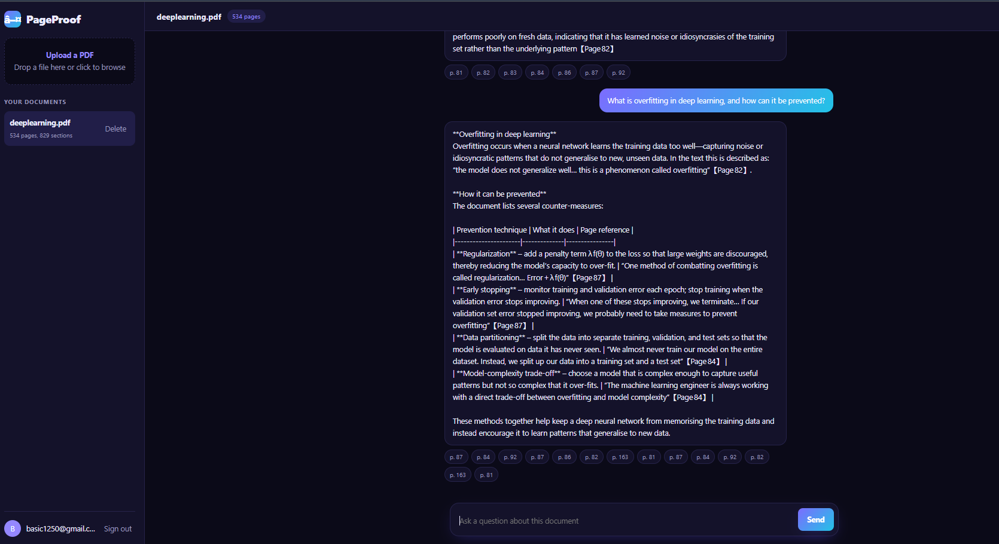
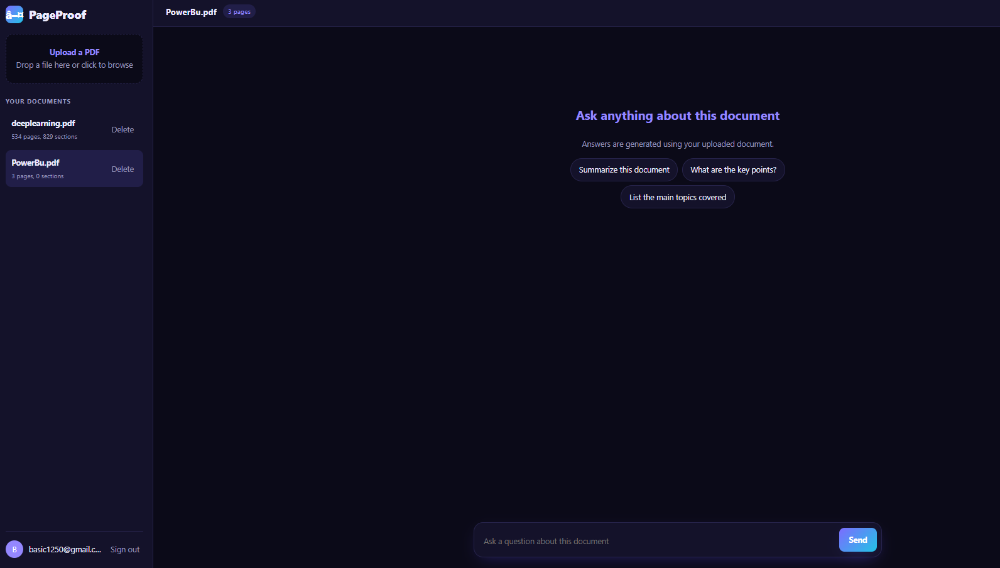

# PageProof-AI

**Document-grounded question answering with Retrieval-Augmented Generation (RAG), page-level citations, and user-specific document access.**

PageProof-AI is a full-stack PDF question-answering application built with **FastAPI**, **HTML/CSS/JavaScript**, **LangChain**, **Hugging Face embeddings**, **ChromaDB**, and a **Groq-hosted language model**. Users can register, upload PDFs, ask natural-language questions about their documents, inspect supporting page references, and revisit document-specific conversation history.

The project prioritizes answers grounded in retrieved PDF content rather than general-purpose chatbot responses. It can decline questions when the available document context does not support an answer. As with any RAG system, citations and answers should still be checked against the original document.

> **Project status:** Implemented locally and evaluated on a 50-question benchmark. Public deployment is not yet documented.

## Contents

- [Why PageProof-AI?](#why-pageproof-ai)
- [Features](#features)
- [Technology stack](#technology-stack)
- [Architecture](#architecture)
- [RAG workflow](#rag-workflow)
- [API reference](#api-reference)
- [Security and data isolation](#security-and-data-isolation)
- [Local setup](#local-setup)
- [Evaluation and results](#evaluation-and-results)
- [Project structure](#project-structure)
- [Screenshots](#screenshots)
- [Limitations and roadmap](#limitations-and-roadmap)
- [Troubleshooting](#troubleshooting)

## Why PageProof-AI?

Searching long PDFs manually is time-consuming, and general chatbots may answer from their own training data without indicating where an answer came from. PageProof-AI combines document indexing, semantic retrieval, and an LLM to provide a searchable Q&A experience tied to an uploaded document. It also keeps documents and chat histories associated with the authenticated user.

## Features

- **User accounts:** Registration, login, and JWT-protected API access.
- **PDF ingestion:** Upload PDFs, extract page text, and index document chunks.
- **Semantic retrieval:** Search indexed chunks with Hugging Face embeddings and ChromaDB.
- **Grounded Q&A:** Generate answers using retrieved document context with a Groq-hosted LLM.
- **Page references:** Return supporting page metadata and expandable source snippets when available.
- **Out-of-document handling:** Decline unsupported questions rather than knowingly answer from unrelated knowledge.
- **Conversation history:** Save and display Q&A history for each user and document.
- **Document management:** List and delete a user's documents and associated indexed content.
- **Responsive UI:** Vanilla HTML/CSS/JavaScript interface with drag-and-drop upload and light/dark theme support.

## Technology stack

| Area | Implementation |
| --- | --- |
| Frontend | HTML, CSS, JavaScript, Fetch API |
| Backend | Python, FastAPI, Uvicorn |
| Authentication | JWT bearer tokens, password hashing |
| Relational persistence | SQLAlchemy, SQLite (local configuration) |
| PDF processing | PDFPlumberLoader / PDF text extraction |
| RAG orchestration | LangChain |
| Text splitting | RecursiveCharacterTextSplitter |
| Embeddings | HuggingFaceEmbeddings |
| Vector store | Persistent ChromaDB |
| Language model | Groq-hosted LLM (model configured in the application) |
| Evaluation | Custom CSV-based question set and Python scripts |

## Architecture



**Persistence responsibilities:** The relational database stores user, document, and chat records; ChromaDB stores vectorized document chunks and metadata; the local uploads directory stores original PDFs. These local stores are not inherently durable on ephemeral cloud hosting.

## RAG workflow

### 1. Ingestion

1. The authenticated user uploads a PDF through `POST /upload`.
2. FastAPI creates a document record linked to the user.
3. The application saves the PDF, extracts page text, and splits it into overlapping chunks.
4. Each chunk is embedded and indexed in ChromaDB with document and page metadata.
5. The API returns document metadata after processing.

**Configured chunking:** approximately **1,500 characters per chunk** with **350 characters of overlap** (based on the project's reviewed RAG configuration).

### 2. Question answering

1. The frontend sends a question and document ID to `POST /ask` with a JWT.
2. The backend checks that the requested document belongs to the authenticated user.
3. The RAG engine retrieves relevant chunks from that document (the reviewed configuration uses `k=8` by default, with special handling for some chapter queries).
4. The retrieved text and optional recent conversation history are supplied to the LLM.
5. The answer and available source-page metadata are returned to the frontend.
6. The question, answer, and source pages are saved in chat history.

**Grounding policy:** The prompt directs the LLM to use retrieved document content and to refuse unsupported requests. This reduces hallucination risk but does **not** guarantee factual correctness or perfect citation relevance.

## API reference

The application defines **seven primary REST API endpoints**, excluding the root HTML route and the static-file mount.

| Method | Path | Authentication | Purpose |
| --- | --- | --- | --- |
| `POST` | `/register` | No | Create an account |
| `POST` | `/login` | No | Authenticate and obtain an access token |
| `POST` | `/upload` | JWT | Upload and index a PDF |
| `GET` | `/documents` | JWT | List the current user's documents |
| `DELETE` | `/documents/{doc_id}` | JWT | Delete an owned document and its indexed content |
| `POST` | `/ask` | JWT | Ask a question about an owned document |
| `GET` | `/history/{doc_id}` | JWT | Retrieve an owned document's conversation history |

The backend also serves `/` for the HTML interface and mounts `/static` for static assets. While running locally, interactive API documentation is available at **http://127.0.0.1:8000/docs**.

### Example Q&A request

After logging in and receiving a JWT, send a request similar to:

```http
POST /ask HTTP/1.1
Authorization: Bearer <YOUR_ACCESS_TOKEN>
Content-Type: application/json

{
  "document_id": 2,
  "question": "What is overfitting?",
  "use_history": false
}
```

The API responds with an `answer` and a `sources` array. Each source can include a page number and a short text snippet. The sample document ID is illustrative; use an ID returned by your own upload.

## Security and data isolation

- Passwords are stored as hashes rather than plaintext; password-hashing implementation is delegated to the authentication module.
- Login issues JWT bearer tokens used by protected endpoints.
- The backend checks document ownership before Q&A, history retrieval, and deletion.
- Document listing is filtered to the authenticated user.
- Document indexing and retrieval use document IDs to restrict the RAG context.
- `.env`, local database files, vector-store data, uploaded PDFs, and virtual environments should **never** be committed.

> **Security scope:** These are implementation-level controls, not a claim of a completed security audit or production hardening. Before public deployment, review token expiry and secrets, upload size/type validation, rate limiting, HTTPS, CORS, database migrations, logging, and persistent storage.

## Local setup

### Prerequisites

- Windows with PowerShell (commands below); Python **3.10** was used during development.
- Git and a Groq API key.
- Enough disk space for Python dependencies and the embedding model's local cache.

### 1. Clone

```powershell
 git clone https://github.com/YOUR_USERNAME/PageProof-AI.git
 cd PageProof-AI
```

Replace `YOUR_USERNAME` with the repository owner's GitHub username after creating the repository.

### 2. Create a virtual environment

```powershell
python -m venv .venv
.\.venv\Scripts\Activate.ps1
```

### 3. Install dependencies

```powershell
python -m pip install -r requirements.txt
```

### 4. Configure environment variables

Create `.env` in the repository root. Set the **Groq API key** and any other variables required by `app/config.py`. For example:

```dotenv
GROQ_API_KEY=replace_with_your_own_key
```

**Check `app/config.py` before publishing an `.env.example`:** other configuration names and model settings may be required by your specific version. Never paste a real key into README or commit `.env`.

### 5. Start the backend

In terminal 1, from the project root with the environment activated:

```powershell
python -m uvicorn app.main:app --reload --port 8000
```

- API docs: http://127.0.0.1:8000/docs
- Backend root: http://127.0.0.1:8000/

### 6. Start the frontend

In terminal 2, from the project root:

```powershell
python -m http.server 5500 --directory static
```

Open **http://localhost:5500**. The reviewed frontend uses `http://127.0.0.1:8000` as its API base URL. Both processes must be running for this two-terminal setup.

### 7. Basic smoke test

1. Register a new account and log in.
2. Upload a PDF and wait for indexing to finish.
3. Ask a question answered by the PDF and inspect the cited pages.
4. Ask an unrelated question and inspect the refusal behavior.
5. Check conversation history and delete the document.
6. For access-control testing, sign in as a second user and confirm the first user's document is inaccessible.

## Evaluation and results

The project was tested using **50 custom questions** against *Fundamentals of Deep Learning, Second Edition*. Questions covered document lookup, concepts, reasoning, and information outside the uploaded document.

### Original full benchmark

| Category | Questions | Fully correct | Partial | Incorrect |
| --- | ---: | ---: | ---: | ---: |
| Document lookup | 10 | 4 | 1 | 5 |
| Concepts | 15 | 12 | 1 | 2 |
| Reasoning | 15 | 15 | 0 | 0 |
| Out-of-document | 10 | 10 | 0 | 0 |
| **Total** | **50** | **41** | **2** | **7** |

- **Strict answer accuracy:** **41/50 = 82%** (partial answers are not counted as correct).
- **Out-of-document refusal rate:** **10/10 = 100%** for the evaluated questions.
- **Evaluation method:** Custom expected-answer comparison with manual review of substantive answers; this is **not** a third-party benchmark or independently audited result.
- **Citation quality:** Page-level source metadata is returned, but citation relevance was **not independently scored** across all questions.

### Targeted retest

After retrieval-related changes, nine previously incorrect or partial answers were retested: **3 fully correct, 1 partial, and 5 incorrect**. Assuming the 41 previously correct responses remained correct, the updated score would be **44/50 = 88%**, but this is **an estimate, not a verified full-benchmark result**. The published headline metric remains **82%** until all 50 questions are rerun on the updated version.

### Reproducing evaluation locally

The repository includes evaluation scripts and a question CSV. The scripts expect a previously indexed evaluation PDF and a matching local document ID. A fresh clone does **not** include the uploaded PDF, database, or ChromaDB index.

```powershell
python evaluate.py
```

Before running, confirm the document ID configured in the script, upload/index the intended evaluation PDF, and check Groq rate/token limits. The evaluation script may overwrite local result CSVs. Results are excluded from Git by default to avoid publishing local data unintentionally.

## Project structure

```text
PageProof-AI/
├── app/                         # FastAPI backend, auth, models, RAG logic
│   ├── main.py                  # API routes and application setup
│   ├── rag.py                   # Ingestion, embeddings, retrieval, QA
│   ├── auth.py                  # Authentication helpers
│   ├── config.py                # Application configuration
│   └── ...                      # Schemas, database and models
├── static/                      # HTML/CSS/JavaScript frontend assets
│   └── index.html               # Main frontend entry point
├── frontend/                    # Additional frontend files, if retained
├── evaluate.py                  # Full evaluation runner
├── evaluate_failed.py           # Targeted retest runner
├── retry_errors.py              # Retry failed evaluation calls
├── evaluation_questions.csv     # Evaluation question set
├── requirements.txt
├── .gitignore
└── README.md
```

Local-only artifacts such as `.env`, `app.db`, `chroma_db/`, `uploads/`, and evaluation output CSVs are intentionally excluded from version control.

## Screenshots

## Application Screenshots

### 1. Landing Page and Authentication


### 2. Document Question Answering with Citations


### 3. Document Management Dashboard



Add real screenshots after verifying that no API keys, personal data, or private PDF content is visible.

Suggested captures:

1. Login / registration page
2. Document upload and document list
3. Document-grounded answer with expanded source citation
4. Chat history and light/dark theme

To display screenshots in GitHub Markdown, place them in `docs/screenshots/` and add image links, for example:

```markdown

```

Do not add placeholder or fabricated screenshots as if they were real application captures.

## Limitations and roadmap

### Known limitations

- Some chapter-title and specialized terminology questions are not retrieved reliably.
- An LLM can still produce an incorrect answer even when context is supplied.
- Returned source pages do not guarantee that every cited snippet supports the entire answer.
- Large PDFs can require significant indexing time and memory.
- Local SQLite, uploaded files, and ChromaDB require a persistence plan before deployment.
- External LLM APIs impose rate and token limits.

### Planned improvements

- Hybrid semantic + keyword retrieval for exact titles and names.
- Reranking and tighter citation-to-claim alignment.
- Automated retrieval and citation-quality metrics in addition to answer accuracy.
- Production-oriented storage, file validation, monitoring, and deployment.
- Full 50-question reevaluation after retrieval changes.

## Troubleshooting

| Symptom | What to check |
| --- | --- |
| `requirements.txt` not found | Run commands from the folder containing `requirements.txt`. |
| Frontend says `Failed to fetch` | Confirm FastAPI is running on port 8000, frontend on port 5500, and the frontend API URL matches. |
| Login or upload fails | Inspect the backend terminal and API response in browser developer tools. |
| Groq `429` error | Review rate/token limits and retry after the applicable window; reduce unnecessary evaluation calls. |
| Embedding model download is slow | Allow the initial Hugging Face model download and verify connectivity and disk space. |
| Answers are missing or incorrect | Confirm the PDF was indexed, the correct document ID is used, and the source pages actually contain the answer. |
| Git shows personal folders outside project | Verify `git rev-parse --show-toplevel` points to this project before staging or committing. |

## Responsible use

Use the application only with PDFs you are authorized to upload and process. Avoid uploading sensitive or confidential documents to third-party inference services without appropriate authorization. Review generated answers and original source pages before relying on them for consequential decisions.

## License

No open-source license has been selected yet. Add a `LICENSE` file only after choosing the intended licensing terms.
